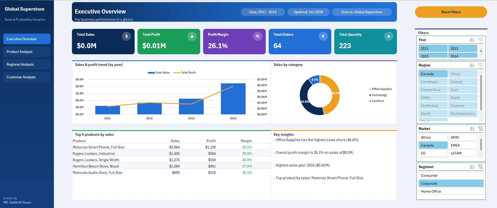
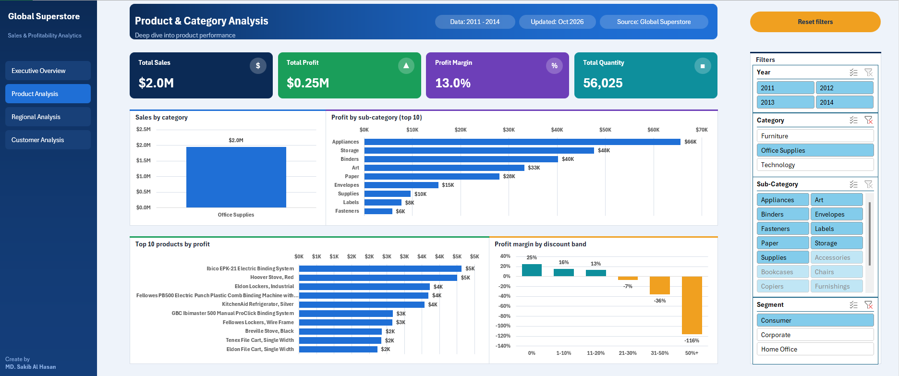
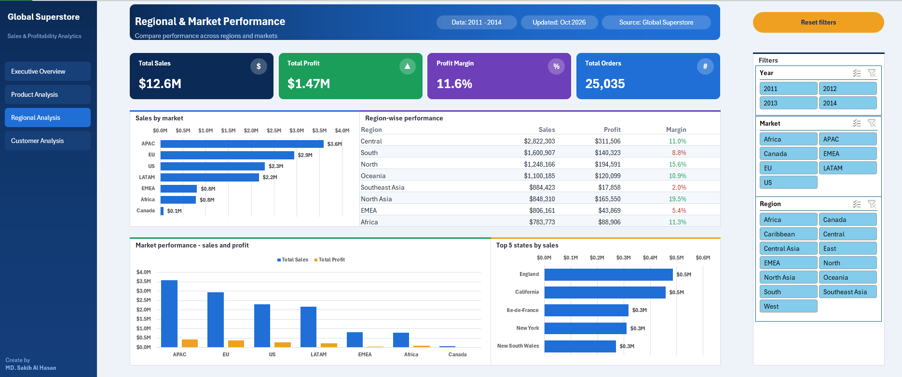
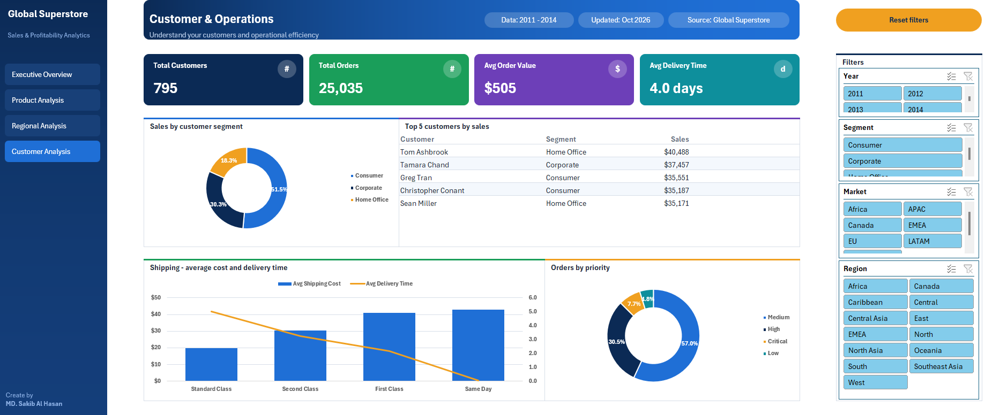

# Global Superstore Sales & Profit Dashboard (Excel)

**By MD. Sakib Al Hasan** · [Portfolio](https://sakibzzz641.github.io) · [GitHub](https://github.com/sakibzzz641) · [LinkedIn](https://www.linkedin.com/in/sakibzzz641)

---

## Summary

I turned **25,035 retail orders (2011-2014)** into a **4-page interactive Excel dashboard** that answers questions about sales, profitability, products, regions, customers and shipping.



**Video walkthrough:** _add your LinkedIn or YouTube link here_

- **Dataset:** Global retail sales, 2011-2014 (US$12.6M sales, US$1.47M profit)
- **Type of analysis:** Descriptive + diagnostic business performance analysis
- **Tools:** Power Query, Excel Data Model, DAX measures, PivotTables, PivotCharts, slicers

**What I built**
- **Executive Overview:** KPIs, sales and profit trend, category share
- **Product Analysis:** profit by sub-category, top products, discount impact
- **Regional Analysis:** market and region performance, top states
- **Customer & Operations:** segments, top customers, shipping and order priority

Every page has its own slicers, so the numbers and charts update together.

**Key insights**
- Sales grew every year and peaked in 2014 at US$4.30M
- Technology leads with 37.5% of total sales
- Discounts above 20% push profit margin below zero
- Some top-selling products have thin margins, so sales rank alone is misleading

**Biggest lesson:** a dashboard is not about charts, it is about answering the right business question quickly.

No coding needed to use it: open the file, click a slicer, and every KPI and chart on that page updates.

---

## Table of Contents
1. [Business Problem](#business-problem)
2. [Dataset](#dataset)
3. [Dashboard Pages](#dashboard-pages)
4. [Key Insights](#key-insights)
5. [Recommendations](#recommendations)
6. [How I Built It](#how-i-built-it)
7. [DAX Measures](#dax-measures)
8. [How to Use](#how-to-use)
9. [Repository Structure](#repository-structure)
10. [Skills Demonstrated](#skills-demonstrated)
11. [What I Learned](#what-i-learned)
12. [Future Improvements](#future-improvements)
13. [Author](#author)

---

## Business Problem

A global retailer sells furniture, office supplies and technology products across many markets. Management wants quick answers to questions like:

- How are sales and profit changing over time?
- Which categories, sub-categories and products make the most profit, and which look good on sales but earn little?
- Which markets and regions perform best, and which are weak?
- Who are the most valuable customers and segments?
- How do discounts, shipping mode and order priority affect results?

This dashboard answers these questions on one screen per topic, with filters for year, region, market, segment, category and sub-category.

---

## Dataset

- **Source:** Global Superstore retail sales dataset (raw file: `Raw_Data/Global_Superstore2.xlsx`)
- **Period:** 2011 - 2014
- **Size:** 25,035 unique orders, 795 customers, 178,312 units sold
- **Main fields:** Order ID, Order Date, Ship Date, Shipping Mode, Customer Name, Segment, City, State, Country, Market, Region, Category, Sub-Category, Product Name, Sales, Quantity, Discount, Profit, Shipping Cost, Order Priority
- **Currency:** US dollars

| Metric | Value |
|---|---|
| Total sales | $12,642,502 |
| Total profit | $1,467,427 |
| Profit margin | 11.6% |
| Total orders | 25,035 |
| Total customers | 795 |
| Average order value | $505 |
| Average delivery time | 4.0 days |

---

## Dashboard Pages

### 1. Executive Overview
Key business performance at a glance.
- 5 KPI cards: Sales, Profit, Margin, Orders, Quantity
- Sales and profit trend by year (columns + line)
- Sales share by category (donut)
- Top 5 products by sales with profit and margin
- Auto-updating key insights text

_(Screenshot at the top of this page.)_

### 2. Product & Category Analysis
Deep dive into product performance.
- 4 KPI cards: Sales, Profit, Margin, Quantity
- Sales by category
- Profit by sub-category (top 10)
- Top 10 products by profit
- Profit margin by discount band (shows where discounts start to hurt)



### 3. Regional & Market Performance
Where the business wins and where it struggles.
- 4 KPI cards: Sales, Profit, Margin, Orders
- Sales by market
- Region-wise table: sales, profit and margin (green/red margin colours)
- Market sales vs profit
- Top 5 states by sales



### 4. Customer & Operations
Customers and delivery efficiency.
- KPIs: customers, orders, average order value, average delivery time
- Sales by customer segment
- Top 5 customers by sales
- Shipping cost and delivery time by shipping mode
- Orders by priority



Every page has its own slicers on the right-hand filter panel, plus a **Reset filters** button.

---

## Key Insights

**1. Steady growth.** Sales rose every year, and profit grew faster than sales early on.

| Year | Sales | Profit | Margin | Sales growth |
|---|---|---|---|---|
| 2011 | $2.26M | $248.9K | 11.0% | - |
| 2012 | $2.68M | $307.4K | 11.5% | +18.5% |
| 2013 | $3.41M | $407.0K | 11.9% | +27.2% |
| 2014 | $4.30M | $504.2K | 11.7% | +26.3% |

**2. Discounts above 20% destroy profit.** Profit margin by discount band:

| Discount | Margin |
|---|---|
| 0% | 25% |
| 1-10% | 17% |
| 11-20% | 10% |
| 21-30% | -6% |
| 31-50% | -32% |
| 50%+ | -111% |

**3. Technology leads.** Technology brings 37.5% of sales, Furniture 32.5% and Office Supplies 30.0%. Copiers ($259K) and Phones ($217K) are the most profitable sub-categories.

**4. Top sales does not always mean top profit.** Apple Smart Phone is the best-selling product ($86.9K) but earns only a 6.8% margin. Canon imageCLASS 2200 Advanced Copier sells less ($61.6K) but has a 40.9% margin and the highest product profit ($25.2K).

**5. Regional gaps.** APAC is the biggest market ($3.6M). Southeast Asia (2.0%) and EMEA (5.4%) have the weakest margins, while North Asia (19.5%), Central Asia (17.6%) and North (15.6%) are the strongest.

**6. Customers and orders.** Consumers generate 51.5% of sales, Corporate 30.3% and Home Office 18.3%. Most orders are Medium priority (57.0%). Average delivery takes about 4 days.

---

## Recommendations

- **Limit discounts to 20%.** Anything higher leads to loss-making sales.
- **Review pricing and costs for low-margin products** such as the best-selling Apple Smart Phone.
- **Investigate Southeast Asia and EMEA.** Sizeable sales ($884K and $806K) but very thin margins point to cost, discount or pricing problems.
- **Promote high-margin lines** such as copiers and North/Central Asian markets.
- **Look at shipping.** Check whether faster shipping modes justify their cost for each priority level.

---

## How I Built It

1. **Loaded and cleaned the data with Power Query**
   - Set correct data types (text, date, decimal, whole number, percentage)
   - Changed `Profit` from whole number to decimal so totals are accurate
   - Added helper columns: `Delivery Time` (`Ship Date - Order Date`), `Year`, `Year-Month`, and `Discount Band` (0%, 1-10%, 11-20%, 21-30%, 31-50%, 50%+)
2. **Loaded the data into the Excel Data Model** to use DAX measures and distinct counts (orders and customers).
3. **Created DAX measures** for every KPI so all PivotTables share one definition.
4. **Built PivotTables** on a separate calculation sheet (one per chart or table).
5. **Created PivotCharts** and formatted them (combo chart, donuts, bars, columns).
6. **Added slicers** for each page and connected them to that page's PivotTables.
7. **Designed the dashboard layout**: navy sidebar with page navigation, gradient banner, KPI cards with icons, white panels with coloured top lines, striped tables and conditional colours.

---

## DAX Measures

```DAX
Total Sales        = SUM('Sheet1'[Sales])
Total Profit       = SUM('Sheet1'[Profit])
Profit Margin      = DIVIDE([Total Profit], [Total Sales])
Total Orders       = DISTINCTCOUNT('Sheet1'[Order ID])
Total Quantity     = SUM('Sheet1'[Quantity])
Avg Delivery Time  = AVERAGE('Sheet1'[Delivery Time])
Avg Discount       = AVERAGE('Sheet1'[Discount])
Total Customers    = DISTINCTCOUNT('Sheet1'[Customer Name])
Avg Order Value    = DIVIDE([Total Sales], [Total Orders])
Avg Shipping Cost  = AVERAGE('Sheet1'[Shipping Cost])
```

> The table is named `Sheet1` in my Data Model. Rename it in the formulas if yours is different.

---

## How to Use

1. Download [`Global Super Store Dataset.xlsm`](Workbook/Global%20Super%20Store%20Dataset.xlsm) from the `Workbook` folder of this repository.
2. Open it in **Microsoft Excel 2016 or later** (Windows recommended; the Data Model and slicers need the desktop version). The file is macro-enabled (`.xlsm`), so click **Enable Content** if Excel asks.
3. Set the zoom to **100%**.
4. Use the **sidebar** to switch between the four pages.
5. Click the **slicers** on the right to filter by year, market, region, segment, category or sub-category. Click the funnel icon on a slicer to clear its filter, or press **Reset filters** to clear all of them.

---

## Repository Structure

```
.
├── Workbook/
│   └── Global Super Store Dataset.xlsm    # the dashboard
├── Raw_Data/
│   └── Global_Superstore2.xlsx            # original dataset
├── Dashboard_Photo/
│   ├── Executive_Overview.png
│   ├── Product_Analysis.png
│   ├── Regional_Analysis.png
│   └── Customer_Analysis.png
├── LICENSE
└── README.md
```

---

## Skills Demonstrated

- Data cleaning and transformation with **Power Query**
- Data modelling with the **Excel Data Model**
- Writing **DAX measures**
- Summarising data with **PivotTables** and **PivotCharts**
- Interactive reporting with **slicers**
- **Dashboard design**: layout, colour, hierarchy and storytelling
- Business analysis: finding insights and turning them into recommendations

---

## What I Learned

- A dashboard is not about charts, it is about answering the right business question quickly.
- Small details, such as the correct data type for `Profit`, change the final numbers.
- Splitting a large dashboard into focused pages is easier to read than one crowded page.
- Looking at profit margin, not only sales, changes which products and regions look "best".

---

## Future Improvements

- Add year-over-year change arrows on the KPI cards using a Date table
- Add a customer-level view (repeat customers, retention)
- Rebuild the same dashboard in Power BI for comparison
- Add a short forecast of the 2015 sales trend

---

## Author

**MD. Sakib Al Hasan**

Explore my projects, technical skills, and professional profile.

[](mailto:sakibzzz641@gmail.com)
[](https://github.com/sakibzzz641)
[](https://linkedin.com/in/sakibzzz641)
[](https://sakibzzz641.github.io/)

---


_If you find this project useful, feel free to star the repository and share your feedback. What would you add to this dashboard?_
